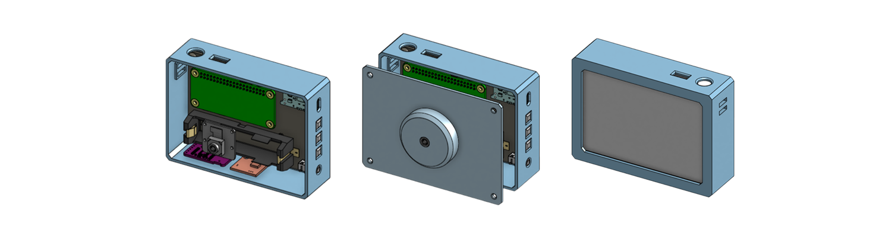
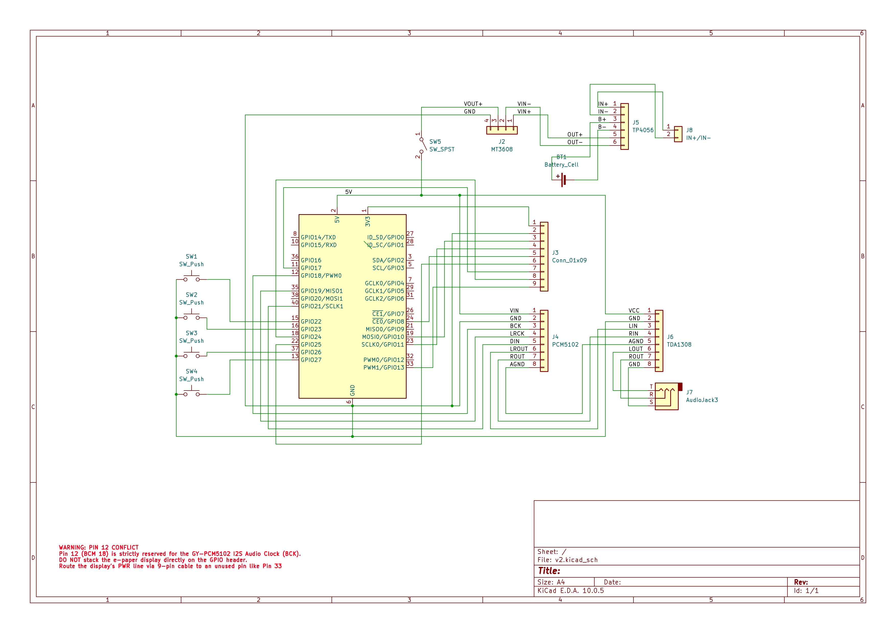
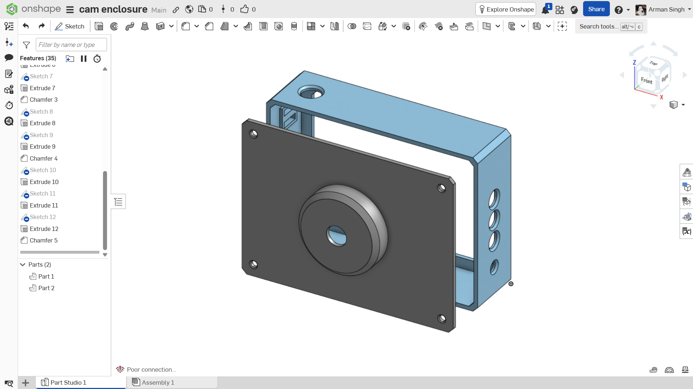

# e-paper camera
A camera that remembers only one photo (on screen at least), and works as an mp3 player too (cuz why not).



## What is it
wanted a digicam for a while, but the old ones are unreliable (& expensive ofc) and new cheap ones are just junk. so i decided to build one myself. i also wanted an mp3 player, totally different itch. since i was already building custom hardware for the camera, figured why not squeeze that in too (big brain)

**ok here's what it would actually do:** <br>
there's no gallery, no scrolling, the e-paper just shows your last shot and it stays there forever until next shot. every pic still gets saved properly though, and it wifi backs up to laptop/phone in the background the second photo is taken, nothing ever actually gets lost even though the screen only shows the one pic (you can change which pic shows from the phone/laptop dashboard too).


## Electronics
| Parts | Desc |
| --- | --- |
| Waveshare 4inch e-Paper HAT+ (Spectra 6, color) | main display board, e-paper is needed to fulfill that "last pic stays permanently" concept |
| Raspberry Pi Zero 2 W | mcu, only board with enough hardware to handle everything, more mentioned in QnA below |
| Raspberry Pi Camera Module 3 | camera unit, pi cam module 2 could be used too but didn't want to compromise on image quality |
| Raspberry Pi Zero CSI Camera Cable | pi zero's csi port is smaller than cam module 3's stock cable so needed this to connect them |
| 18650 Li-ion Cell (Molicel INR-18650-P30B) | battery cell, picked this specific one for enough capacity and physical fit in the enclosure
| 18650 Cell Holder | house for the cell |
| TP4056 Charging Module | needed for charging the cell over usb c with overcharge/overcurrent protection |
| MT3608 Step Up Module | boosts the cell's output to stable 5V which will be used by Pi, PCM5102A DAC, and TDA1308 amp |
| Latching Power Switch (SPST) | physical on/off button |
| PCM5102A I2S DAC Module | handles the actual mp3 audio output |
| TDA1308 Amplifier Module | DAC's line level audio output isn't enough for clean headphone quality, so this stage would boost it for better quality |
| MicroSD Card (32GB) | storage for both music library and photos |
| Buttons x4 (Shutter & Music Controls) | 1 shutter button + 3 music control buttons |
| Hookup Wire & Jumper Cables | wiring between modules (no custom PCB. please see note below) |
| M3 Screws | for the enclosure |

## Wiring
> [!NOTE]
>  this schematic shows the wiring which would be done by using jumping wires, there's no custom pcb design proposed yet, so no board screenshot or 3D render to show. If the wiring gets messy, i would consider designing a custom pcb and upload it exactly here :) 



> [!WARNING]
> pin 12 conflict: GPIO18/BCM18 is reserved for the PCM5102A's I2S clock (BCK), so don't stack the e-paper HAT directly on that pin, current plan is to slightly bend it to route around the conflict, but that's unconfirmed until i've got the actual hardware.

## Enclosure


## CAD Model
**Complete CAD model is available on [ONSHAPE](https://cad.onshape.com/documents/ab0129b0ffcb553a41fd978a/w/1af2f7c9bc0d2e8a4e4feb4b/e/cccda6b71561c05696152eb3?renderMode=0&uiState=6a9196cf4e41288969f92849)**

## Firmware
basic firmware is in the [`firmware/`](./firmware) folder. shutter takes a photo, dithers it to 6 colors and shows it on the e-paper. the other 3 buttons play music.

```
firmware/
├── audio.py    # mp3 playback (pcm5102 -> tda1308 -> jack)
├── camera.py   # takes a full res photo with cam module 3
├── display.py  # shows an image on the e-paper
├── dither.py   # crops to 600x400 + floyd-steinberg dithering
└── main.py     # reads the buttons, runs everything
```

| button | gpio | press | hold |
| --- | --- | --- | --- |
| shutter | 22 | take photo | - |
| play/pause | 23 | play / pause | audio-only mode (shutter off) |
| next | 26 | next song | volume up |
| prev | 27 | previous song | volume down |

**setup**
1. enable I2S, SPI and camera in `raspi-config`
2. `sudo apt install python3-pygame python3-gpiozero python3-pil python3-picamera2`
3. copy the `waveshare_epd` folder from waveshare's demo (4inch_e-Paper_E.zip) into `firmware/lib/`
4. put mp3s in `~/music`, photos get saved to `~/photos`
5. `python main.py`

u can try the dithering on your pc without any hardware: `python dither.py photo.jpg preview.png`

> [!NOTE]
> e-paper only refreshes once every 3 min (waveshare recommends it), so if u shoot faster the photo is still saved and the screen catches up later. wifi backup is not in the firmware yet. nothing is tested on real hardware yet except the audio logic (dummy driver)

## Status
schematic, enclosure and basic firmware done. pcb layout + fab files will come after the parts arrive, nothing built or tested on hardware yet

## QnA

### why pi zero 2 w and not esp32?
this is the one part i'm not swapping for something cheaper. the pi can do a lot of things at the same time and an esp32 can't really keep up

1. **camera**: cam module 3 is 13MP, the best camera i found for an esp32 is around 5MP
2. **ram**: the spectra 6 display needs a big buffer just to process one image before showing it. an esp32 doesn't have that much ram, and music is also playing at the same time
3. **doing many things at once**: taking a photo, dithering it for the e-paper, sending it over wifi, playing mp3s and reading 4 buttons all happen together. on an esp32 this would probably lag or crash
4. **wifi + storage**: wifi backup and a full photo + music library on one sd card is easy on linux. on an esp32 i would have to write most of that myself and the result would be worse

### why added TDA1308 Amplifier?
PCM5102A outputs line level audio, not enough to drive headphones cleanly. Without the extra amp stage, there would be weak volume and/or audio quality issues.

TDA1308 is specifically built for this. it's literally specified as a headphone driver stage

### how long the battery would last?
there are two real world scenarios:
1. idle/music playback: Pi ~130mA  + DAC ~20mA + amp ~20mA + e-paper standby ~0mA ≈ ~170mA
2. photo capture: Pi under load (~500mA) + camera (~250mA) + e-paper refresh (~14mA) ≈ ~760mA

the battery is 2850 mAh @3.6v = 10.26Wh

then through the boost converter (3.6V to 5V, ~85% efficiency): <br>
usable energy at 5V = 10.26Wh × 0.85 ≈ 8.72Wh <br>
effective capacity at 5V = 8.72Wh ÷ 5V ≈ 1744mAh

this means:
1. idle/music playback: 1744mAh ÷ 170mA ≈ 10.3 hrs of continuous music playback
2. photo capture: this ~760mA is just a few seconds spike per shot, so the overall battery life is still around or just slight (~30 mins) less than 10.3 hrs

NOTE: the power usage of each component are estimates from various sources, will swap in real multimeter readings once built.

## Credits
not a clone of [reFrame](https://github.com/kaloyaan/reframe), though that's what got me thinking about this